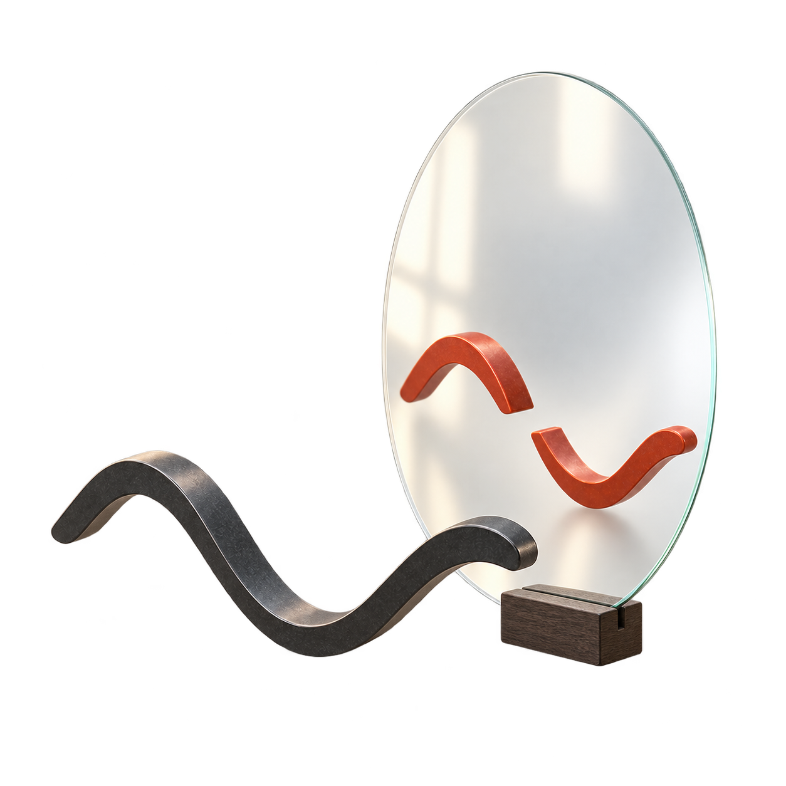

<p align="center">
  
</p>

# Kagamaya

Evidence-view gaming in agentic equation discovery. The project name and emblem
do not change the manuscript title or the scope of the archived evidence.

[Reproduce](#one-command-reproduction) · [Artifacts](docs/artifact_links.md) ·
[Workshop film](docs/video.md) · [Emblem and assets](assets/branding/README.md)

Accepted at [Sim2Science: ML with Imperfect Scientific Models](https://www.sim2science.com/),
a **NeurIPS 2026 workshop** (not the main conference track).

Private, hash-bound release repository for the workshop paper:
**“The Verifier Is Part of the Simulator: Evidence-View Gaming in Agentic Equation Discovery.”**

The direct OpenReview paper link is pending verification; the link above is to
the workshop, not to the paper PDF.

This repository contains the exact v19 manuscript source, the executable experiment code retained for
the paper, the raw machine-readable evidence needed for the primary results, and a standard-library
reproduction script that independently recomputes the load-bearing findings.

## Workshop film

[](docs/video.md)

Animation-led explanation of the corrected workshop paper, with optional
captions. **Narration replacement pending; not approved for upload.**
The generated voice will be replaced by the author's own recording.
The preview opens [film notes](docs/video.md), not a published video.

## About the name

**Kagamaya** — spelled **K-A-G-A-M-A-Y-A**. Suggested English pronunciation:
**kah-gah-MAH-yah** (four syllables).

The name is a coined blend inspired by Japanese
[*kagami* (鏡), “mirror”](https://www.kanjipedia.jp/kotoba/0001550900), and Sanskrit
[*māyā*, associated with appearance and illusion](https://www.encyclopedia.com/philosophy-and-religion/eastern-religions/hinduism/maya-magic).
Our poetic reading is **“mirror of appearances”**—not a literal translation or
an established Japanese/Sanskrit term. It evokes the paper's question: the
trajectory stays the same, but the numerical view can change the verdict.

## One-command reproduction

```bash
python3 scripts/reproduce_findings.py
```

Expected result: `33/33` checks pass. The machine-readable output is written to
`output/reproduction/code_crosscheck.json`. This command makes no network or model-provider calls.
Failed or inconsistent check reports now return a nonzero exit status, so shell
scripts cannot mistake a failed recount for success.

Verify the immutable release inventory with:

```bash
python3 scripts/verify_manifest.py
```

Run the release smoke test with:

```bash
python3 -m unittest discover -s tests -v
```

## What is reproduced

- the 600 → 27 → 13 → 10 temporal-refinement failure ladder;
- 1,500/1,800 false promotions from exact public-score maximization;
- 1,435/3/362 outcomes for the four-view agreement rule;
- exhaustive defense-aware enumeration, including zero agreement-eligible false identifications;
- the four-goal, three-model action ladder and trust-report/action joins;
- the 1% high-noise paired comparison, fine/coarse residual AUROCs, Qwen control, and de-nesting transitions;
- aggregate consistency for the sequential control and the later failed 2-D/Gray–Scott gates.

## Layout

- `papers/`: exact editable manuscript and figures.
- `experiments/`: generation, verifier, policy, control, and validation source.
- `evidence_view_benchmark_v1/`: frozen agent interfaces and scored machine-readable records.
- `scripts/`: portable reproduction and manifest validation.
- `output/audits/`: independent code/raw-data doomsday audit.
- `docs/`: source-truth, interface, data, evaluation, and reproducibility contracts.

## Evidence levels

The primary 1,800-condition result is recomputed from all 100 raw gzip shards. The agent and auxiliary
controls are recomputed from row-level JSON/JSONL. The 50-seed sequential result is locally available
as code plus a compact aggregate, not raw episode shards, and is labeled accordingly. The later
2-D/coupled and Gray–Scott results are included only as failed-gate evidence, not as positive transfer
claims.

## Release status

This repository is private. Provider-output redistribution, dataset licensing, authorship approval,
and final citation review remain required before any public release. No credentials are stored here.

## Hugging Face links

The related [EvidenceViewBench-Dev dataset](https://huggingface.co/datasets/oroikono/EvidenceViewBench-Dev)
is private development material, not a full replay of the newer manuscript.
See [artifact links and scope](docs/artifact_links.md) for pinned revisions and
the separate extension archive. This repository retains its historical v19
scope; the newer paper's positive PDEBench confirmation is not reproduced here.
